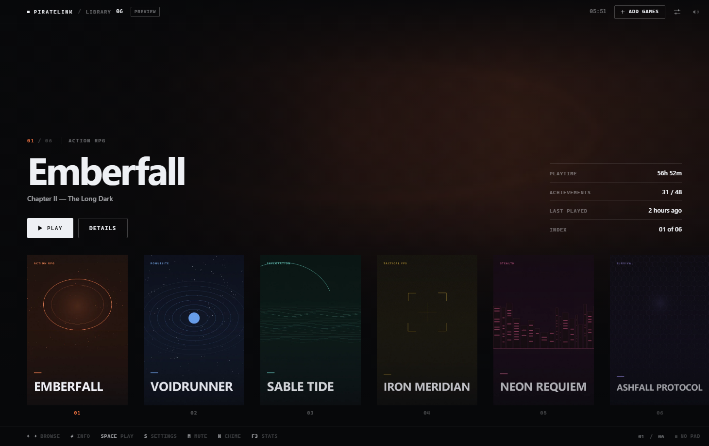
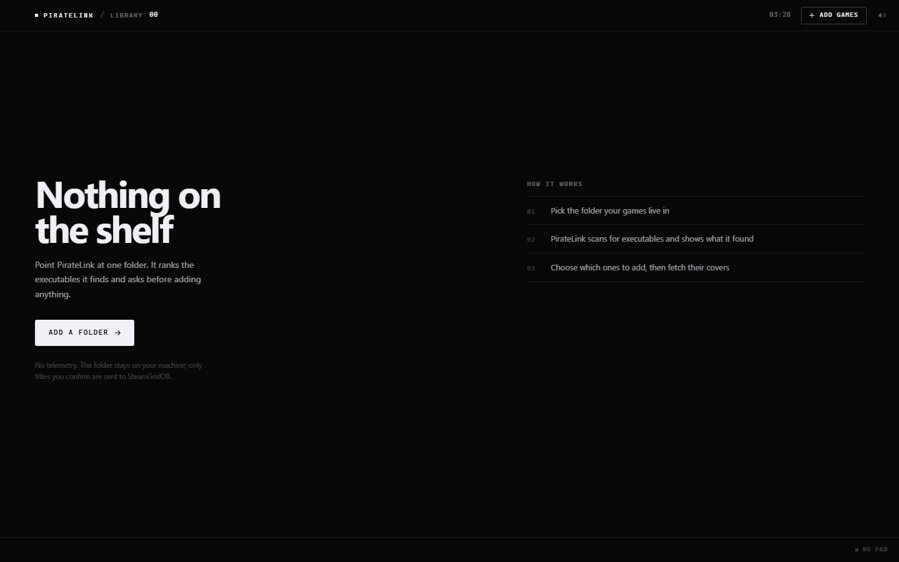
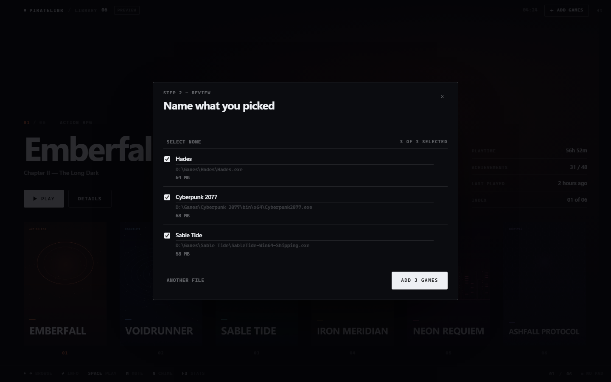
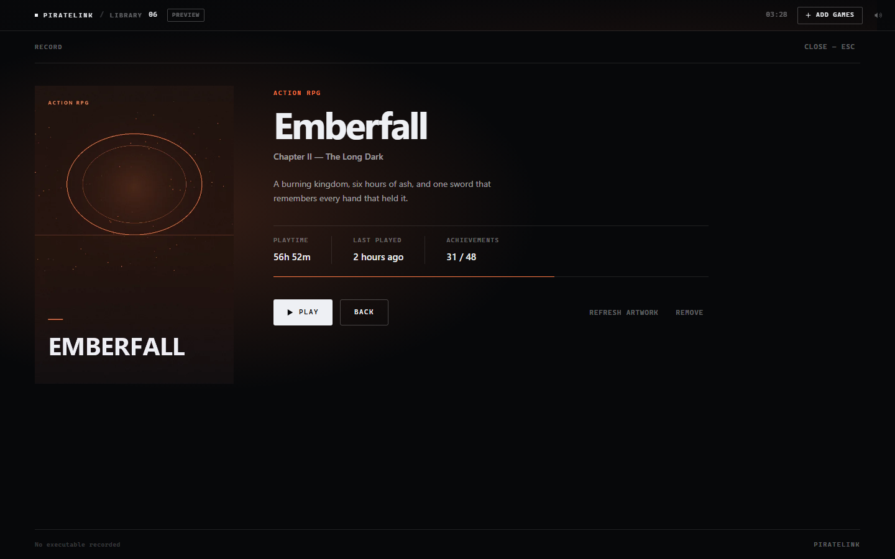
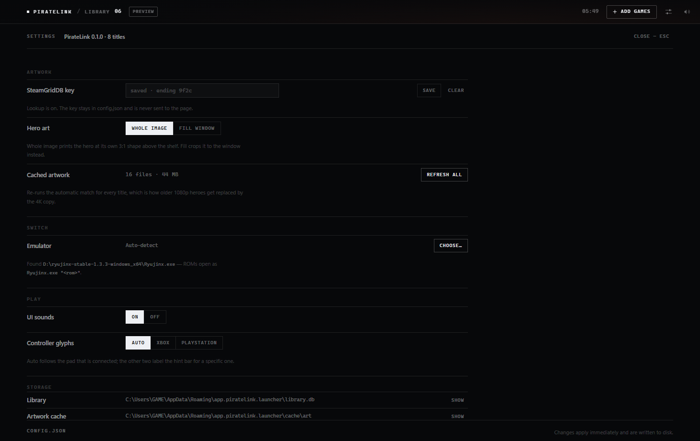

# PirateLink

A console-style game shelf for Windows: a printed-catalogue layout, one row of
cover plates, hairline rules, monospace metadata, spring physics, and UI sound —
built on Tauri v2 + Svelte 5 + Rust, with a memory budget it does **not** currently
meet (see below).

**Status: Phase 1 and Phase 2 complete.** Pick a game's `.exe` — or a Switch dump
(`.nsp`, `.xci`, `.nro`) — confirm the title PirateLink derived for it, and the
cover is fetched from SteamGridDB and cached to disk. Artwork that the automatic
match refuses can be picked by hand. The memory target is not hit yet.



---

## What works right now

| Area | Detail |
| --- | --- |
| Shelf | Filmstrip of uniform plates on one baseline; the selection is pinned to the left margin, wraps at both ends, ~6 covers decoded |
| Library | SQLite under the app data dir; add a game by picking its `.exe` or a Switch dump (`.nsp`, `.xci`, `.nro`), correct the suggested title, remove entries |
| Artwork | SteamGridDB cover at 600 px and hero at up to 3840 px (the 4K copy is preferred over the 1920×620 one), stored without resampling and losslessly as WebP, served from the cache. **Change art** opens a picker: search SteamGridDB by hand, then click the cover or hero to apply it |
| Switch | A ROM is recognised by extension, launched as `Ryujinx.exe "<rom>"`, and gets the same shelf, art and import flow as a PC game |
| Input | Keyboard (`←` `→` `Enter` `Space` `Esc` `M` `N` `S` `F3`) **and** gamepad (Xbox / DualSense / DualShock, standard mapping, D-pad or left stick, hold-to-repeat). The hint bar labels itself for whichever device was used last, so a pad shows `× ○ □ △` or `A B X Y`; R3 opens Add games and L3 opens Settings, though the `.exe` picker itself is the Windows dialog and still needs a mouse |
| Motion | Custom critically-damped spring in `src/lib/spring.svelte.ts`; parks its `requestAnimationFrame` loop the moment it settles |
| Audio | One 27 KB OGG sprite, five cues, sliced at playback |
| Window | Frameless, custom titlebar, drag region, native min/max/close |
| Boot | ~260 ms fade, then the shelf |

| | | |
| --- | --- | --- |
|  |  |  |

## Switch games

A `.nsp`, `.xci` or `.nro` is treated as a console title, not as an executable:

| Piece | Behaviour |
| --- | --- |
| Recognition | Extension only, case-insensitive. The platform is derived on the Rust side from the picked file, never trusted from the webview |
| Title | The filename, cleaned: dump ids (`[0100F2C0115B6000]`), versions (`[v0]`), regions (`(USA)`) and `(Rev 1)` are stripped. It stays editable in the import sheet |
| Launch | `Ryujinx.exe "<rom>"`. The emulator is looked for in `ryujinx_path` from `config.json` first, then in known install locations, then in a two-level scan of the ROM's drive and the system drive |
| Failure | If no emulator is found, `launch_game` returns the reason and the toast shows it. Nothing is guessed |
| Artwork | The same SteamGridDB pipeline. SGDB keys games by title rather than by platform, so Switch releases resolve through the same search as PC ports — no second database. (ScreenScraper and TheGamesDB are noticeably weaker for modern Switch art) |
| Shelf | Identical. A ROM row carries a `switch` stamp in the import sheet and a *Platform: Switch* fact in its record |

```jsonc
// %APPDATA%\app.piratelink.launcher\config.json
{
  "steamgriddb_api_key": "<key>",
  "ryujinx_path": "D:\\ryujinx-stable-1.3.3-windows_x64\\Ryujinx.exe"
}
```

`ryujinx_path` is optional; forks (Ryubing and friends) work the same way — point it
at whichever `Ryujinx.exe` you actually run.

## Settings

`S`, `L3`, or the sliders button in the top right opens one page. There is no
global *Save*: every control writes `config.json` the moment it changes, so the
file and the screen cannot disagree.



| Section | Entry | What it does |
| --- | --- | --- |
| Artwork | SteamGridDB key | Save, clear, or keep the existing key (shown as `saved · ending 9f2c`). Takes effect without a restart |
| | Hero art | **Whole image** shows the full 3:1 hero above the shelf; **Fill window** crops it to the window |
| | Cached artwork | File count and size, plus *Refresh all*, which re-runs the automatic match for every title so older 1080p heroes become 4K |
| Switch | Emulator | *Choose…* picks any `Ryujinx.exe`; *Auto* clears the path and goes back to detection. The line under it says what was actually found |
| Play | UI sounds | On/off, the same value `M` toggles |
| | Controller glyphs | Auto follows the connected pad; Xbox/PlayStation force the hint bar |
| Storage | Library, artwork, log, config | Prints the real paths and opens them in Explorer (`/select,` for files) |
| About | — | Version, credits, key list |

The hero setting exists because the two shapes cannot both be satisfied. SteamGridDB
heroes are ~3.1:1 (3840×1240) and a 16:9 window is ~1.6:1, so `cover` shows **51 %** of
the picture at 1460×921 — measured, not estimated. *Whole image* prints the bitmap at
its own aspect and masks its lower edge into the page instead of leaving a seam.

```jsonc
// %APPDATA%\app.piratelink.launcher\config.json
{
  "steamgriddb_api_key": "<key>",
  "ryujinx_path": "",
  "hero_fit": "fit",          // "fit" | "fill"
  "glyphs": "auto",           // "auto" | "xbox" | "playstation"
  "sound": true
}
```

Unknown values fall back to the defaults rather than being written back, and a key
supplied by `PIRATELINK_SGDB_KEY` is never persisted by opening this page.

## What is deliberately *not* in the box

The Goldberg / `gbe_fork` auto-injector from the original plan (Phase 3) is not
implemented and will not be. `gbe_fork` exists to satisfy Steam's ownership check
for copies the user does not own, so a one-click injector with backup/restore is
DRM circumvention rather than a launcher feature. The other four phases stand on
their own and are unaffected.

---

## Measured on this machine

| Metric | Value |
| --- | --- |
| Frontend bundle (`dist/`) | 309 KB across 19 files |
| Main JS / CSS | 102 KB (37 KB gzip) / 30 KB (6.8 KB gzip) |
| Release `.exe` (`tauri build --no-bundle`) | 7.1 MB (image, HTTP/TLS and SQLite linked in) |
| Decoded hero | 4.5 MB raster at 1920×620, 18.2 MB at 3840×1240 — the backdrop is the largest single allocation on screen |
| Renderer JS heap | 4.5 MB (`F3` overlay) |
| **Whole-process RAM** | **461 MB — over the 200 MB target** |
| `scanner` walk, `D:\Games` (10 installs) | ~50 ms, 13 candidates (backend only — the UI adds one `.exe` at a time) |

### Memory is not where it should be

Measured on the running release build: **55.4 MB** in the Tauri process and
**405 MB across seven WebView2 processes**, 461 MB total. The 200 MB ceiling from
the brief is not met, and this README previously implied it was without ever
having measured it.

`tools\measure-memory.ps1` samples the app plus its whole child tree, so this is a
number we can move deliberately:

```powershell
powershell -ExecutionPolicy Bypass -File tools\measure-memory.ps1 -Seconds 30
```

Suspects that were tested in the catalogue rework, and are now gone:

1. **The film-grain overlay** — a full-screen `feTurbulence` SVG with
   `mix-blend-mode: overlay`, forcing a composited full-screen layer. Removed.
2. **`backdrop-filter` panels** — blur cost scales with surface area. Every glass
   surface is now solid. Removed.
3. **The drifting hero** — a 1920x620 layer painting continuously, even when idle.
   The backdrop is static now. Removed.

What is left is the WebView2 baseline itself (~120-200 MB here before any of our
content). The number needs re-measuring against a Tauri build, not the dev server.

## Requirements

- **Rust** 1.77+ — this machine builds with `x86_64-pc-windows-gnu`; `tauri-build`
  needs MinGW's `windres`. The MSVC target works if VS Build Tools are installed.
- **Node** 20+ (built on Node 24, Vite 8)
- **WebView2 runtime** — already present on Windows 11 and patched Windows 10

## Getting started

```powershell
npm install
npm run tauri:dev      # dev window with HMR (starts Vite for you)
npm run tauri:build    # release .exe + NSIS installer
```

Preview the built UI in a browser, without Tauri:

```powershell
npm run build
node tools\serve.mjs --port 4174 --root dist
```

The preview runs the real components against an in-memory backend, so the whole
flow is clickable without the app: `?preview=empty` starts with an empty library,
"Add games" walks the import sheet, and confirmations land on the shelf. That is
how the screenshots here are produced (`tools/shoot.mjs`).

Regenerate all art, audio and the icon (deterministic, offline):

```powershell
python tools\make_assets.py
npx tauri icon tools\icon-1024.png
```

### Which binary to run

| Artifact | Standalone? |
| --- | --- |
| `src-tauri/target/release/piratelink.exe` | ✅ embeds the app — double-click it |
| `npm run tauri:dev` | ✅ but it owns a Vite process |
| `src-tauri/target/debug/piratelink.exe` | ❌ **black window** |

A Tauri *debug* binary does not embed the frontend: it points at
`http://localhost:1420` and expects `npm run dev` to be running. Launched on its
own it paints the window background and nothing else. That is a Tauri build-mode
behaviour, not an app bug — for a double-clickable debug build, use
`npx tauri build --debug --no-bundle`.

---

## Verification

Run and passing:

```
npm run check      -> 0 errors, 0 warnings
npm run build      -> 301 KB dist
cargo test --release --lib -> 58 passed, 2 ignored (live)
npx tauri build --no-bundle -> target/release/piratelink.exe
```

`--release` because this sandbox refuses to load the *debug* test binary
(`STATUS_ENTRYPOINT_NOT_FOUND`), and it also denies `%TEMP%` writes from spawned
binaries, so the suite runs with `TEMP` pointed inside `target\testtmp`. Neither is
a property of the code: the same tests pass unchanged on a normal desktop.

Two build-level traps worth recording:

- **The CSS minifier silently removed every glass panel.** `app.css` shipped both
  `backdrop-filter` and `-webkit-backdrop-filter`; Lightning CSS collapsed the pair
  to the *prefixed* form, and Chromium 155 does not implement that alias at all, so
  every frosted surface rendered flat while the source looked correct. The prefixed
  line is gone, and the built CSS is checked after each build.
- **`protocol-asset` is a crate feature, not just config.** Turning on
  `assetProtocol` in `tauri.conf.json` fails the build script until
  `tauri = { features = ["protocol-asset"] }` is also set.

**The Tauri window does not start in the environment this was built in.** The
binary panics during setup with `Access is denied (os error 5)` from WebView2
environment creation. This is not project configuration: a stock, minimal
`tauri.conf.json` with one plain decorated window fails identically here, while
`notepad.exe` and headless Edge both run fine. It reproduces only under the agent
sandbox, so `npm run tauri:dev` is expected to work on a real desktop.

Because of that, the UI is verified by serving the production bundle and driving
Edge over the DevTools Protocol. That server sends the **same CSP** the packaged
app uses, so policy regressions show up there rather than only inside the `.exe`.
This is how the `media-src blob:` hole was caught: the audio layer had moved to
blob URLs, which the original policy blocked.

Audio is verified out-of-band: the sprite decodes to 2.86 s with peak 0.902, and
every cue window contains signal at its manifest offset (tick 0.062 RMS, select
0.188, back 0.149, chime 0.189, open 0.230). Browser playback could **not** be
confirmed in this environment — this Edge build has no compressed-media decoder
for Web Audio, and media requests were answered by an intermediary with
`204 No Content`. `src/lib/audio.ts` therefore ships both engines and picks one at
runtime.

---

## Layout

```
src/
  app.css                 design tokens, label/panel/button primitives
  App.svelte              state, action dispatch, hero + stage composition
  lib/
    games.ts              Game view model + demo entries for the browser preview
    library.ts            the only module that talks to Rust (and the preview backend)
    audio.ts              sprite loader, <audio> + Web Audio engines
    input.ts              keyboard + gamepad -> one Action stream
    spring.svelte.ts      ~50-line critically-damped spring
    components/           Backdrop, TopBar, Carousel, DetailOverlay, ArtSheet, HintBar,
                          Toast, EmptyState, ImportSheet
src-tauri/
  src/db.rs               SQLite schema, migrations, queries
  src/scanner.rs          executable walk, scoring, title cleanup, ROM recognition
  src/emulator.rs         Ryujinx discovery (config, known paths, drive scan) and launch
  src/sgdb.rs             SteamGridDB client, match confidence, asset picking
  src/artwork.rs          decode / downscale / re-encode to WebP
  src/config.rs           app data dir, API key, emulator path
  src/lib.rs              Tauri commands, app state, command log
  tauri.conf.json         frameless window, CSP, asset protocol, bundle config
  capabilities/           window-control and dialog permissions
public/
  art/                    6 covers + 6 backdrops (generated, used by demo/preview)
  audio/                  ui-sprite.ogg + ui-sprite.json
tools/
  make_assets.py          synthesises all audio, art and the icon
  measure-memory.ps1      samples the app + WebView2 child tree over time
  serve.mjs               Range-capable static server, sends the app's CSP
  shoot.mjs               DevTools-protocol screenshots of the UI
  screenshot.ps1          captures the live Tauri window (needs it running)
```

---

## Deviations from the original spec

| Spec | Shipped | Why |
| --- | --- | --- |
| Framer Motion | Custom spring (~50 lines) | Framer Motion is React-only; it cannot drive Svelte components |
| Howler.js | Web Audio + `<audio>` fallback | `start(0, offset, duration)` *is* sprite slicing; no dependency, and the fallback covers decoders that reject compressed audio |
| Tailwind for everything | Tailwind preflight + custom CSS | A bespoke shelf is mostly transforms; utility soup was not smaller |
| Cloudflare Quick Tunnels | Not yet implemented | They mint a random hostname per restart and are explicitly not for production, which is the wrong fit for a presence endpoint clients must reach repeatedly |
| Local `.ogg` from Pixabay/Freesound | Generated from oscillators | Zero licences, zero attribution, reproducible from source |

Two details worth carrying into Phase 4:

- **Bincode**: pin the major version. Bincode 2 replaced `serialize`/`deserialize`
  with `Encode`/`Decode`, so 1.x examples will not compile. Cap frame size and
  version the packet enum before parsing anything off a socket.
- **Presence needs auth before a tunnel.** Nothing in the original plan proved a
  client was a particular account, and a public WebSocket accepts anyone who finds
  the URL.

## Phase 2 — library

Wired end to end: pick `.exe` or Switch dump -> confirm title -> fetch -> shelf.

| Piece | File | Notes |
| --- | --- | --- |
| SQLite library | `db.rs` | `library.db` under the app data dir, WAL, `user_version` migrations; `platform` added by a v1→v2 migration |
| Title from the install folder | `scanner.rs` | `title_for_exe` walks up past `Game` / `bin` / `Win64` and strips release noise; the filename is never used as a title. `title_for_rom` does the opposite: the dump's filename *is* the title, so tags are stripped |
| SteamGridDB | `sgdb.rs` | Bearer auth, tolerant parsing, 429 retry, 125 ms spacing |
| Artwork | `artwork.rs` | Decode, downscale to a 600 px cover / 3840 px hero ceiling, re-encode WebP (JPEG/PNG fallback) |
| UI | `src/lib/library.ts`, `ImportSheet.svelte`, `ArtSheet.svelte` | One module owns the invoke layer; import is choose -> review -> add with an editable title per file, and `ArtSheet` is the manual picker |

The scanner still exists in `scanner.rs` (depth-limited walk, scoring, reasons) but
the UI no longer calls it: picking the file is the judgement the scanner was
guessing at, and it costs the user one click instead of a confirmation screen.

Set the API key once (outside the repo, never committed):

```powershell
# %APPDATA%\app.piratelink.launcher\config.json
{ "steamgriddb_api_key": "<your key>", "ryujinx_path": "<optional>\\Ryujinx.exe" }
```

Tests: **58 unit + 2 live**. The live tests are ignored by default so the suite
stays offline:

```powershell
cargo test                                     # 58 passed
$env:PIRATELINK_SGDB_KEY = "..."
cargo test --lib -- --ignored                  # 2 passed (real API, ~5 s)
```

### How a game is matched to its artwork

Three steps, and all of them had to be right:

1. **Which folder is the title.** `title_for_exe` takes the folder holding the
   executable only if that folder is not structural (`Game`, `bin`, `x64`,
   `Binaries`, `Win64`, `steamapps`, ...); otherwise it walks up. So
   `Elden Ring\Game\eldenring.exe` is titled **Elden Ring**, not "Game" — and never
   "eldenring", which is why the filename is not consulted at all. The suggestion
   is an editable field in the sheet, so a folder named `Games 2` or
   `Hades_v1.38261.2_[FitGirl Repack]` costs a keystroke rather than a wrong cover.
2. **Which search result is the game.** `sgdb::best_match` scores every result
   (exact, then prefix, then token overlap) and requires **0.6 similarity**.
   Below that, `fetch_artwork` returns an error instead of attaching something
   plausible but wrong.

3. **Which copy of the asset.** Heroes come in 1920×620 and 3840×1240, and the
   bigger one is not always first. `pick_best` takes the **largest** asset and
   uses the API's vote order to choose between copies of the same size, so a 3:1
   hero is not stretched over a 1440p window while a 4K one is on offer. Nothing
   is resampled at that point: a 3840-wide hero is stored as-is (losslessly), and
   the window downscales it.

Both the title and the match were wrong once, in a way that silently attached an
unrelated game's cover: searching "Game" returns a title literally named *GAME*. A
wrong cover is worse than no cover — it gets cached, and nothing on screen says it
is wrong.

If a cover is wrong: fix the title in the sheet before adding — the SteamGridDB
search uses the field, not the filename. Afterwards, open the game and use
**Refresh artwork** to re-run the lookup, or **Change art** to choose by hand.

### Change art

The automatic matcher is deliberately strict, which leaves two cases it cannot
serve: games SteamGridDB spells differently, and games whose art the user simply
prefers differently. **Change art** on a game's record covers both:

1. The sheet opens on a SteamGridDB search for the title and loads the first hit.
2. Click another result when the spelling differs. `FC 26` is listed as
   `EA SPORTS FCT 26` — close enough for a human, not for `best_match`, which must
   refuse rather than risk the wrong cover.
3. Click any cover or hero to apply it. Nothing else changes: the asset is
   downloaded, downscaled to the same ceilings, re-encoded to WebP in the same
   cache, and the chosen SteamGridDB id is stored on the row so a later
   **Refresh artwork** starts from the right entry.

Cover and hero are applied independently, so replacing a cover never discards a
hero chosen earlier. The picker marks what it applied with an **in use** stamp for
the session, and cached art is requested with a `?v=` cache-buster — the asset
protocol reads only the path, and without it the webview would keep showing the
previous bitmap after an art change.

### What the live API actually does

Recorded because the published spec does not say any of it:

- **`score` is `0` on every asset.** Ranking covers by "highest score" returns
  whichever element happened to be last. Trust the API's own ordering (already
  vote/relevance sorted) and filter tags instead.
- **Search results are flat** (`{id, name, types, verified, release_date}`), even
  though `components.schemas.Games` implies a nested `Game -> data` shape. The
  parser accepts both.
- **`release_date` is undocumented** and appears on real responses.
- **Heroes are `1920x620`**, not 16:9, so a hero cannot fill a 1080p window without
  being scaled and self-blurred.
- `limit` above 50 is ignored, and grids paginate (`total=255` for a popular
  title), so 50 is the ceiling per request.

## Troubleshooting

**`%APPDATA%\app.piratelink.launcher\piratelink.log`** — the commands that do real
work write a line when they finish; the release build has no console, so this is
the only trace.

| Log shows | Means |
| --- | --- |
| `inspect_file: ... -> "Title"` | the title that will be sent to SteamGridDB — the first thing to check when a cover comes back wrong |
| `inspect_file: not a game file` | the picked path was neither an `.exe` nor a `.nsp`/`.xci`/`.nro`; the sheet shows the same message |
| `apply_artwork: <id> <- sgdb <id> cover ... hero ...` | a manual choice was written to the cache |
| `launch_game: <title> -> <emulator> <rom>` | a Switch title was handed to Ryujinx |
| `launch_game: no emulator for ...` | no `ryujinx_path`, no known install, and the drive scan found nothing; the toast carries the full message |
| nothing after picking a file | the Windows dialog returned nothing (you cancelled), so nothing was inspected |

An import that fails (the file was deleted between picking and adding, the database
is locked) is reported in the sheet, not the log.

## Security and privacy

- **No telemetry, no update pings.** The only network traffic is SteamGridDB when
  you add a game or open the art picker.
- **CSP** is set in `tauri.conf.json` (`default-src 'self'`, inline styles only,
  `blob:` allowed for audio and images). `img-src` additionally allows
  `https://*.steamgriddb.com`, because the picker lays out CDN thumbnails before
  anything is downloaded; `connect-src` stays `'self'`, so the webview cannot make
  arbitrary requests.
- **`launch_game` takes a game id**, not a path: it reads the executable from the
  database, so the webview can request game N but cannot name an arbitrary `.exe`.
- **The API key stays out of the webview.** It lives in `config.json` under the app
  data directory and is only read by the Rust side; no command returns it.
- **Windows Defender will flag the release binary.** Worth stating plainly: a small
  unsigned Rust executable that starts other executables is a shape heuristics
  dislike. Sign the binary if you distribute it, and do not normalise "add this
  file to exclusions" as the fix.

## Roadmap

- **Phase 1 — Shell & audio** ✅
- **Phase 2 — Library & metadata** ✅ SQLite, scanner, SteamGridDB, artwork cache,
  import flow, asset protocol, Switch ROMs via Ryujinx, manual art picker
- **Memory pass** — next: re-measure against a build, then work from the 461 MB
  baseline toward the 200 MB target
- **UI pass** ✅ catalogue layout: no blur, no glow, no pills; art carries the colour
- **Phase 3 — Co-op engine** ❌ dropped (see above)
- **Phase 4 — Social & hosting** — `axum` presence server, binary packets, auth
  before the tunnel, stable hostname
