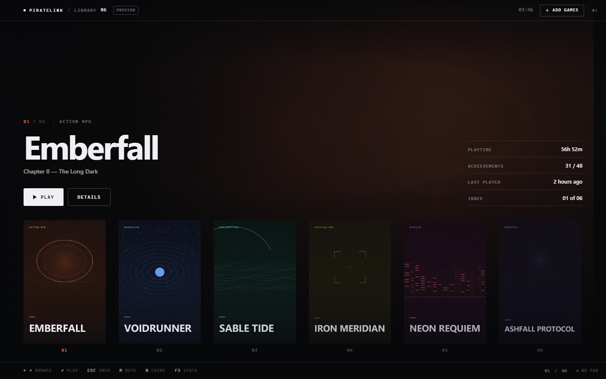

# PirateLink

PirateLink is a Windows game shelf and lightweight multiplayer room launcher built with Tauri 2, Svelte 5, and Rust.



## Current Status

Phase 1 and Phase 2 are complete. The Phase 4 MVP is in progress and currently includes:

- A console-style game shelf with keyboard and gamepad input
- PC `.exe` and Switch `.nsp`, `.xci`, and `.nro` library entries
- SQLite library storage
- SteamGridDB artwork lookup, caching, and manual artwork selection
- Ryujinx launch support for Switch titles
- LAN multiplayer rooms: automatic host address detection, invite links, and
  presence (PING/HELLO)
- UDP room discovery on the local network, with a per-room "invite only" switch
- Optional ZeroTier for players outside the LAN: network detection, one-click
  join, and address polling until the network is ready
- A Settings button that tests the SteamGridDB key end to end

LAN rooms are the default path: both players on the same network need no account
and no extra software. Make sure Windows Firewall allows PirateLink inbound TCP
and UDP the first time, or discovery and presence will be silently blocked.
ZeroTier is only needed when the players are not on one LAN. Temporary network
creation, game launch integration, and Windows invite protocol registration are
next.

## Quick Start

Requirements:

- Windows 10 or later
- Node.js 20+
- Rust 1.77+
- WebView2
- ZeroTier, only for rooms with players outside your LAN

Install dependencies and run the development app:

```powershell
npm install
npm run tauri:dev
```

Build a standalone release executable:

```powershell
$env:TEMP = (Resolve-Path "target\testtmp").Path
$env:TMP = $env:TEMP
npx tauri build --no-bundle
```

The executable is written to `src-tauri/target/release/piratelink.exe`.

Create the unsigned NSIS installer locally:

```powershell
npm run tauri:build
```

The installer is written to `src-tauri/target/release/bundle/nsis/`.
GitHub Actions also builds the installer and portable executable when manually
run or when a version tag such as `v0.1.2` is pushed. Artifacts are available
from the workflow run under **Actions**.

These builds are intentionally unsigned for now, so Windows SmartScreen may
show a warning.

## Multiplayer MVP

1. Install ZeroTier on each computer.
2. Join the same private ZeroTier network and authorize each member in ZeroTier Central.
3. Confirm `zerotier-cli listnetworks` reports `OK` and an assigned address.
4. On the host, open **Room**, choose **Create Room**, and click **Detect ZeroTier**.
5. Create the room and share the invite link.
6. On the guest computer, open **Room**, choose **Join Room**, paste the invite, and click **Join ZeroTier network**.
7. Authorize the guest in ZeroTier Central if required.
8. Wait until the guest's ZeroTier network reports `OK`.

ZeroTier remains a standalone application. PirateLink only coordinates room information and asks the local ZeroTier client to join a network. The current MVP does not require a ZeroTier API key.

## Development Checks

```powershell
npm run check
npm run build
$env:TEMP = (Resolve-Path "target\testtmp").Path
$env:TMP = $env:TEMP
cargo check --manifest-path src-tauri/Cargo.toml
```

The detailed implementation notes, measurements, decisions, and roadmap are in [docs/PROJECT_SPEC.md](docs/PROJECT_SPEC.md).

## License

Apache-2.0. See [LICENSE](LICENSE).
